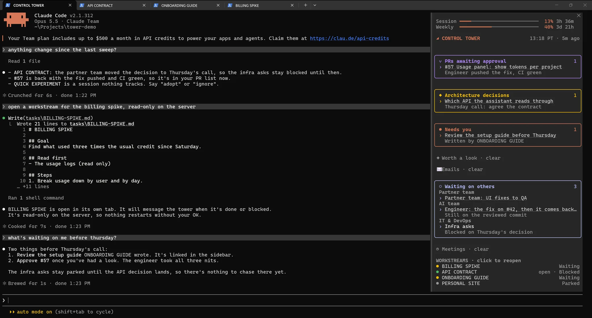
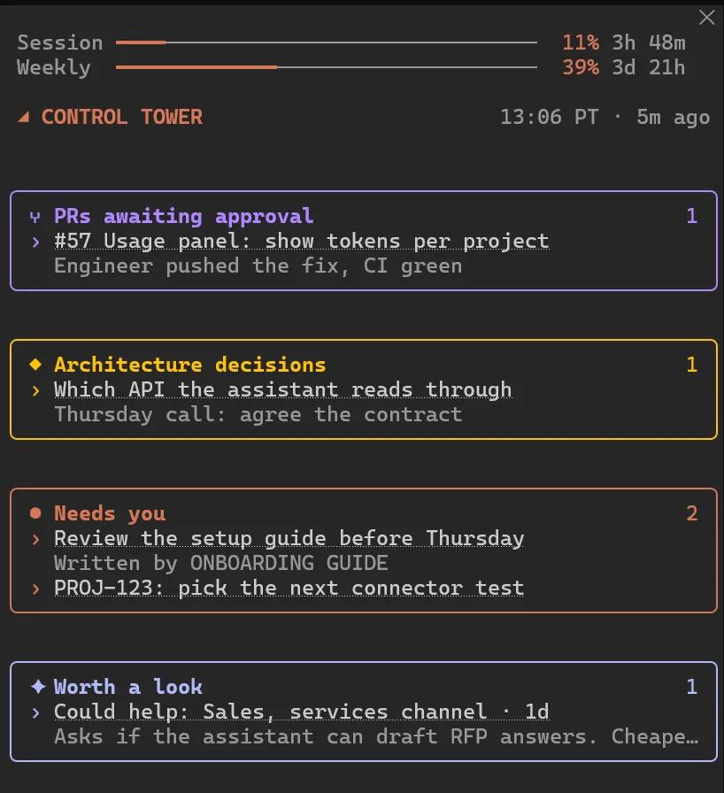
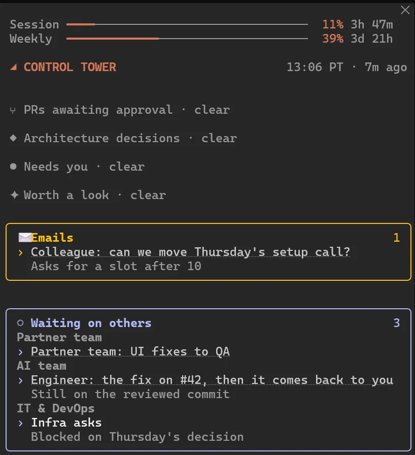
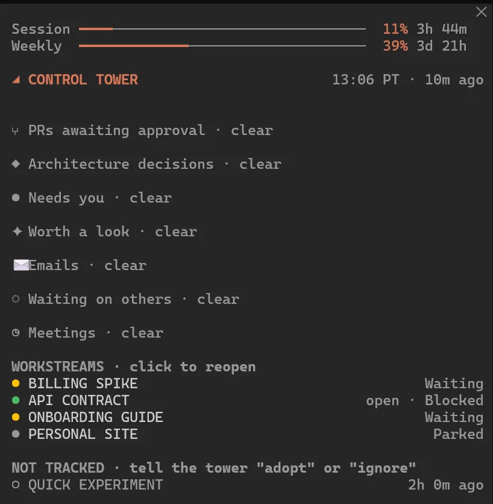

# claude-control-tower

A way to run lots of Claude Code sessions at once without losing track of them.



One session is the **control tower**. It doesn't do the real work. It hands that out to **workstreams**, each a Claude Code session in its own terminal tab, and keeps one status file honest. A **sidebar** in the tower's terminal shows what needs you, what you're waiting on and every workstream, and a click on a workstream reopens it.

The write-up with the reasoning behind all of this is here: https://www.mattdav.is/blog/my-claude-code-control-tower

This is my real setup with the work-specific bits taken out. It's built around how I work, so treat it as a starting point and change whatever doesn't fit you.

## The sidebar

<p>
  
  
  
</p>

Every section folds to "clear" when there's nothing in it. Workstreams show their state from STATUS.md, and a click reopens one. All the data in these screenshots is made up.

## What's in here

```
control-tower/
  README.md
  CLAUDE.example.md            guardrails for ~/.claude/CLAUDE.md (things that always need your OK)
  STATUS.example.md            copy to STATUS.md: one row per workstream
  whats-next.example.json      copy to whats-next.json: what the sidebar draws
  workstream-rules.md          appended to every workstream session's system prompt
  new-workstream.ps1           opens a workstream in a new titled Windows Terminal tab, or resumes one
  start-session.ps1            what runs inside that tab
  untracked.ps1                lists recent sessions no STATUS row tracks (a plain script, no model)
  untracked-ignore.txt         sessions to leave out of that list
  hooks/reload-context.ps1     SessionStart hook: re-injects STATUS.md (tower) or the task file (workstream)
  update-check/                every-other-day check for Claude Code changes worth adopting
  tasks/CONTROL-TOWER.md       the tower's own brief
  tasks/EXAMPLE-WORKSTREAM.md  what a workstream brief looks like
  skills/whats-next/SKILL.md   the sweep: re-check every source, never trust memory
  mods/tower-sidebar/          the sidebar, a Claude Code mod
```

Your own `STATUS.md`, `whats-next.json`, task files, notes and archive are git-ignored, so you can keep your tower in a clone of this without committing your work.

## Setup

Windows, PowerShell, Windows Terminal and Claude Code. The scripts are short, so porting them to bash is straightforward.

### The easy way: ask Claude Code

You don't have to do any of the steps below yourself. Open Claude Code and paste this:

```
Set up the control tower from https://github.com/dattmavis/claude-control-tower for me.
Follow the "Instructions for Claude Code" section in its README.
```

It'll clone the repo, ask you a few questions (where to put it, which guardrails you want, which tools you use), and show you every change to your own Claude Code config before making it.

### Instructions for Claude Code

If a user has asked you to set this up, work through these in order. Ask before changing anything outside the tower folder, and show the exact change first.

1. **Check the platform.** The scripts are PowerShell and expect Windows Terminal. On macOS or Linux, tell the user that, and offer to port `new-workstream.ps1`, `start-session.ps1`, `untracked.ps1`, `hooks/reload-context.ps1` and `update-check/run.ps1` to bash before going further.
2. **Clone** to `~/control-tower` unless the user wants it somewhere else. Use that absolute path, with forward slashes, everywhere below.
3. **Copy the examples:** `STATUS.example.md` to `STATUS.md` and `whats-next.example.json` to `whats-next.json`. Clear the example rows out of `STATUS.md`, keeping the header and table columns.
4. **Guardrails.** Walk the user through `CLAUDE.example.md` one section at a time and ask what fits. Merge what they keep into `~/.claude/CLAUDE.md`, adding to what's there and never replacing their existing rules. Show the result before writing it. Don't skip this step, even if the user says to hurry.
5. **Hook.** Add the SessionStart hook from step 4 of the manual setup below to `~/.claude/settings.json`, with the real path. Merge it into any hooks already there, and show the diff before writing.
6. **Skill.** Copy `skills/whats-next` to `~/.claude/skills/whats-next`. Ask which tools the user works in (code host, chat, email, calendar, tracker) and which of them are connected to Claude Code, then edit the skill's sources to match. Drop the sources they don't use.
7. **Sidebar.** Set `TOWER` at the top of `mods/tower-sidebar/hooks/register.tsx` to the tower folder. Run `claude plugin validate mods/tower-sidebar` and `claude plugin test mods/tower-sidebar`, and fix anything that fails before moving on.
8. **Update check (optional).** Ask whether they want the every-other-day check. Only with a yes, schedule `update-check/run.ps1` (Task Scheduler on Windows, cron or launchd elsewhere).
9. **Hand over.** Give the user the command from step 7 below to start the tower in a new terminal tab. Tell them the tower picks up from `tasks/CONTROL-TOWER.md`, and that from then on they start work by telling the tower what they want.

Never commit the user's `STATUS.md`, `whats-next.json`, task files or notes. The `.gitignore` already covers them.

### By hand

1. **Clone** somewhere permanent, for example `~/control-tower`.
2. **Copy the examples:** `STATUS.example.md` to `STATUS.md` and `whats-next.example.json` to `whats-next.json`.
3. **Guardrails:** merge `CLAUDE.example.md` into `~/.claude/CLAUDE.md` and make it yours. Don't skip this one.
4. **Hook:** add the SessionStart hook to `~/.claude/settings.json`:
   ```json
   "hooks": {
     "SessionStart": [{
       "matcher": "startup|compact|clear",
       "hooks": [{ "type": "command",
         "command": "powershell -NoProfile -ExecutionPolicy Bypass -File C:/Users/you/control-tower/hooks/reload-context.ps1" }]
     }]
   }
   ```
5. **Skill:** copy `skills/whats-next` to `~/.claude/skills/whats-next` and edit its sources to match your tools (code host, chat, email, calendar, tracker).
6. **Sidebar:** set `TOWER` at the top of `mods/tower-sidebar/hooks/register.tsx` to your folder, with forward slashes. Check it with `claude plugin validate mods/tower-sidebar` and `claude plugin test mods/tower-sidebar`.
7. **Start the tower:**
   ```
   powershell -NoProfile -ExecutionPolicy Bypass -File start-session.ps1 -Name CONTROL-TOWER
   ```
   That loads the sidebar with `--plugin-dir` and points the tower at `tasks/CONTROL-TOWER.md`.
8. **Optional:** schedule `update-check/run.ps1` every other day in Task Scheduler.

## Using it

- **Start a workstream:** tell the tower what you want. It writes `tasks/<NAME>.md` and runs `new-workstream.ps1 -Name <NAME>`.
- **Reopen one:** click it in the sidebar. That runs `new-workstream.ps1 -Name <NAME> -ResumeLatest`, which finds the newest session with that title from the `customTitle` in its transcript.
- **Park one:** the session sets its row to Parked and you close the tab.
- **Finish one:** the session sets its row to Done. The next sweep archives the task file once the tab is closed.
- **Adopt a session you started by hand:** it shows under "Not tracked" in the sidebar. Tell the tower "adopt NAME", or "ignore NAME".
- **Sweeps:** the sidebar asks the tower for a read-only sweep every hour during work hours, set by `FIRST_HOUR` and `LAST_HOUR`. `/tower refresh` runs one now.

## License

MIT
